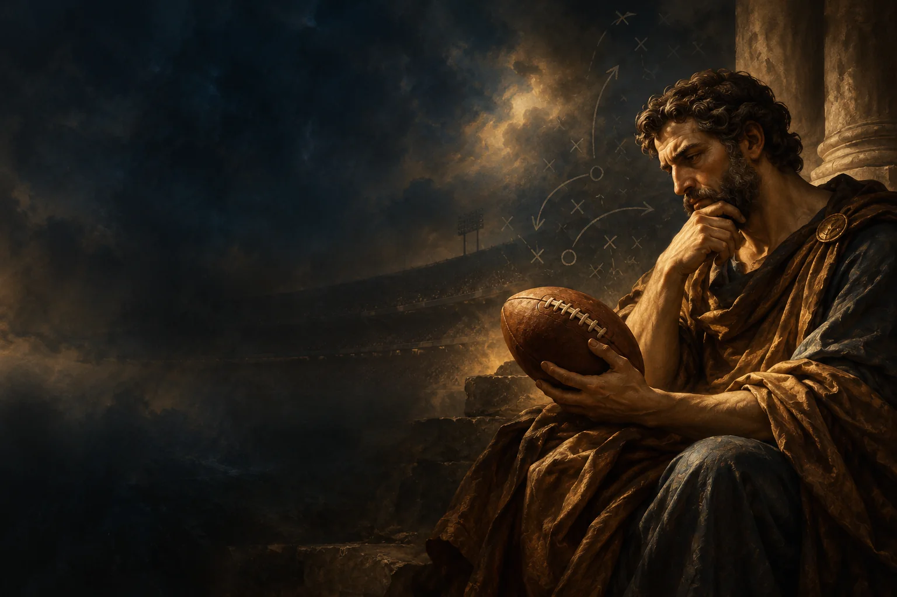
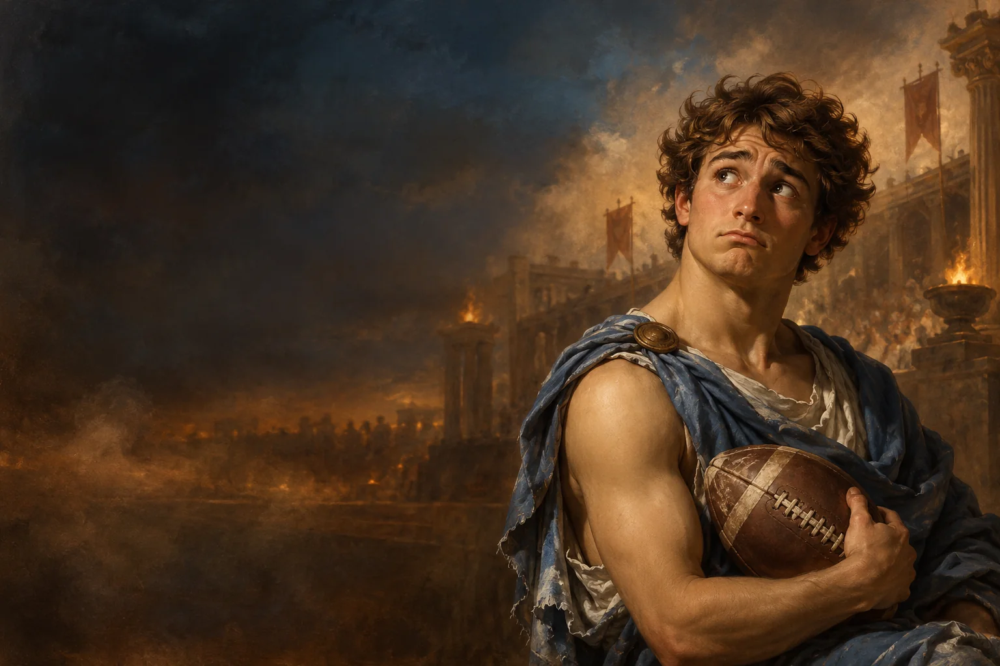
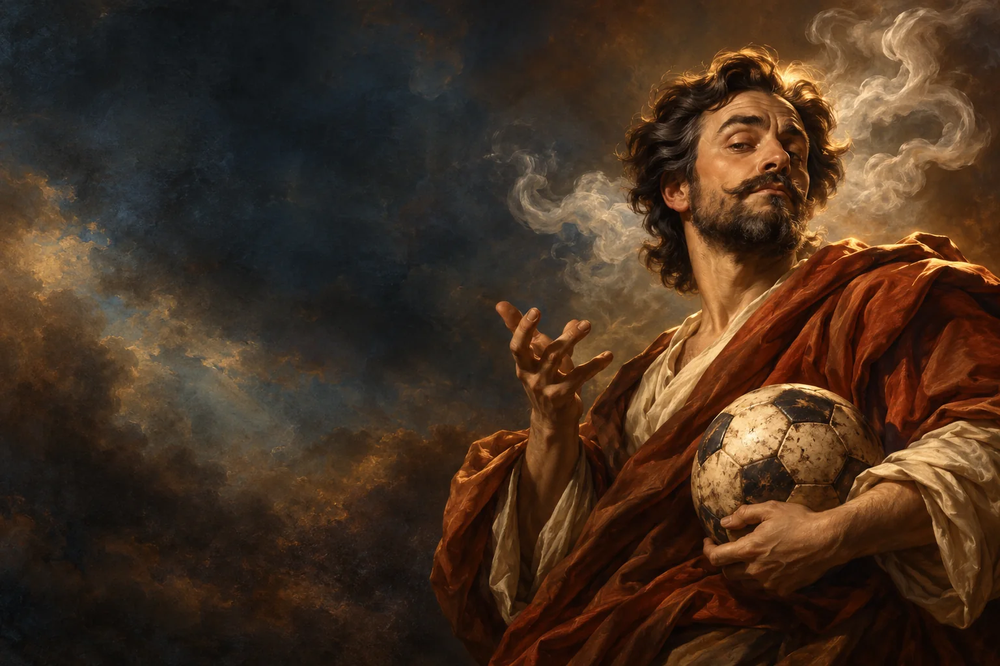

# AE SPORTS · Fondos de comunidad · 19 octubre 2026

Generados con la herramienta integrada ImageGen; exportados a WebP para la web. Los títulos y clasificaciones siguen siendo HTML. Día y noche reutilizan los originales con capas CSS de contraste.

## Prompt compartido

Use case: stylized-concept. Asset type: wide decorative header background for AE SPORTS classical sports community leaderboard. Create a refined old-master oil painting, Caravaggio chiaroscuro with warm bronze, walnut brown, muted dusty blue and ivory; elegant, calm, tactile canvas, cinematic realism, subtle humor where specified. Landscape 1536x1024. Composition: main subject in right third; left 60 percent uncluttered atmospheric dark-blue/brown negative space because real website text overlays there. No text, letters, numbers, logos, watermark, borders, collage or UI. The right subject must be legible even cropped into a wide shallow horizontal banner.

El prompt final de cada imagen concatena el texto compartido con la descripción correspondiente.

## Savant

Archivo: `assets/rankings/ae-nfl-savant-20261019.webp`

NFL SAVANT: a thoughtful classical philosopher in a dark bronze draped robe, studying a vintage American football held low, assured intelligent expression, warm light on face and leather ball, faint tactical chalk curves fading into the background, subtle dark stadium atmosphere. Head and football both in the central horizontal band of image.

## Rookie

Archivo: `assets/rankings/ae-nfl-rookie-20261019.webp`

NFL ROOKIE: a young classical apprentice in a dusty blue draped robe, sheepish puzzled expression, vintage American football tucked awkwardly under one arm; gentle playful irony, tasteful art, warm terracotta haze and dim stadium atmosphere. Bust portrait to right, head and football both in central horizontal band.

## Respira Fútbol

Archivo: `assets/rankings/ae-football-respira-20261019.webp`

RESPIRA FUTBOL: a serene classical football connoisseur in muted blue robe, eyes gently closed as if savoring the game, one hand resting on a worn classic black and ivory soccer ball; restrained laurel detail, soft sage and bronze atmospheric stadium haze. Bust portrait on right, face and ball together in central horizontal band.

## Vende Humos

Archivo: `assets/rankings/ae-football-humos-20261019.webp`

VENDE HUMOS: a theatrical classical sports pundit in walnut and terracotta drapery, confident grandiose expression with slightly raised eyebrow, a worn soccer ball near his torso while wisps of pale smoke curl behind his head as a witty metaphor for exaggerated predictions; witty refined portrait, not clownish, warm copper rim light. Bust portrait on right, head and ball in central horizontal band.
